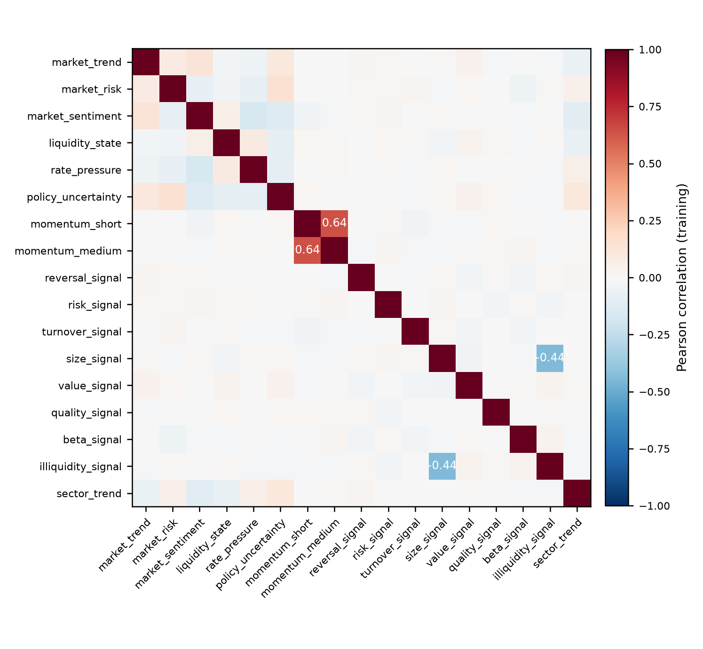
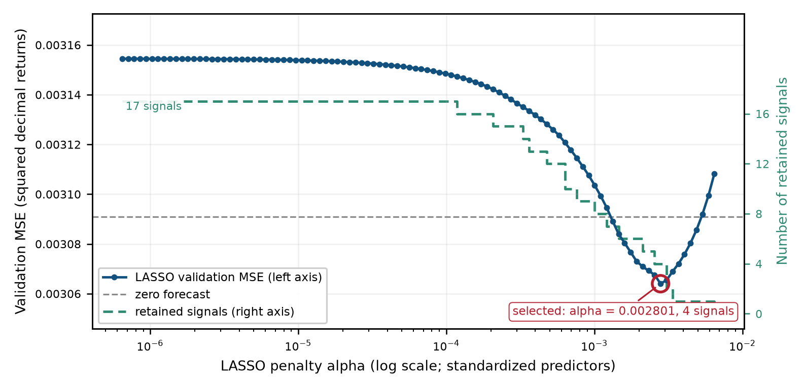
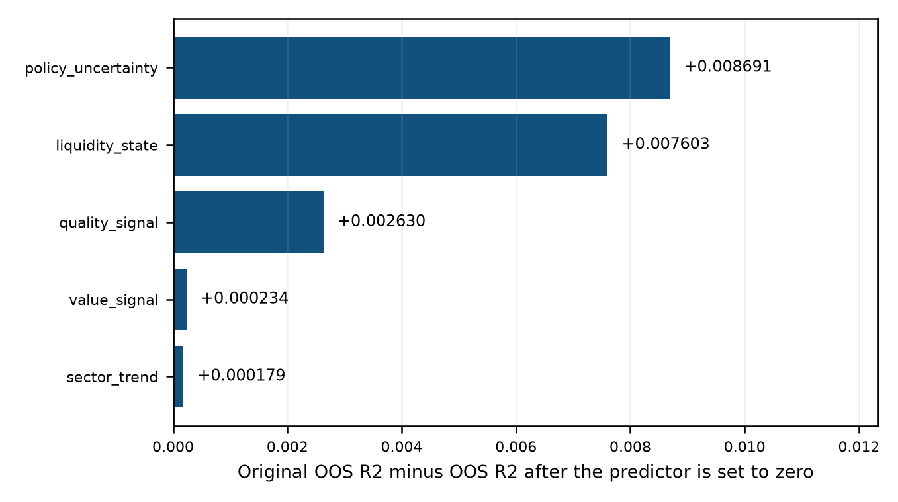
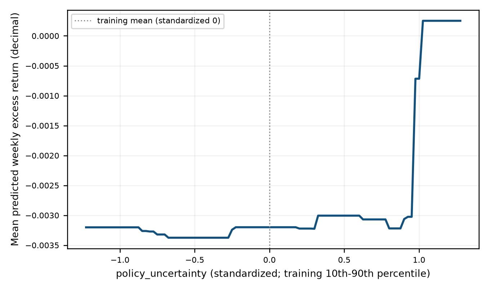

# Machine-Learning Investment Project | 机器学习投资研究项目

**David Hui** · github.com/DavidLearning1023 · October 2026 · MIT

**Weekly cross-sectional return prediction and long-only portfolio construction on an 80-asset panel — one pipeline from data integrity checks to frozen out-of-sample weights.**

**在 80 只资产的面板上做周度横截面收益预测与 long-only 组合构建——一条从数据完整性检查直达冻结样本外权重的流水线。**

---

> **Simulated returns, real methodology.**
> The panel is a real Hong Kong large-cap index constituent list carrying **simulated** returns and signals, which is why it cannot be redistributed; asset identifiers and industry buckets are anonymised throughout. No figure below is a market result or a live-performance record — the deliverable is the method and its diagnostics.
>
> **收益为模拟数据，方法为真。**
> 面板的标的池取自一份真实的中国香港大型股指数成分股名单，其收益与信号均为**模拟**生成，因此不可再分发；资产标识与行业分组一律匿名化。以下没有任何数字是市场结果或实盘业绩记录——本项目交付的是方法本身及其诊断结果。

**📄 [Full technical report (PDF)](docs/report.pdf)** · [Markdown source](docs/report.md) · [Data notes](data/README.md)

---

## What it does | 这个项目做了什么

**中文** 一个 80 只资产 × 260 个预测周的周度面板按日期划分（**绝不打乱**）为 78 个训练周、26 个验证周，以及一个结果被隐藏的 156 周评估窗口。流水线在其上：

1. 校验数据完整性，并设定零超额收益预测基准；
2. 拟合 OLS 与在验证集上调参的 LASSO（100 点对数惩罚路径）；
3. 拟合随机森林，在 6 点复杂度阶梯上选择设定；
4. 用 drop-to-zero OOS R² 在冻结的森林上度量重要性；
5. 在**三窗口稳健综合评分**（夏普 / 信息比率 / 回撤）上给 33 条 long-only top-K 规则打分——一条规则必须在整个验证块**以及**它的两个半块上都表现好；
6. 按窗口对整族规则重新评分，检验稳定性；
7. 在第 1–104 周上把赢家重拟合一次、冻结，并为评估窗口写出 156 个周度权重向量。

**English** A weekly panel of 80 assets × 260 forecast dates is split **by date, never
shuffled** into 78 training weeks, 26 validation weeks and a 156-week evaluation
window whose outcomes are withheld. On it the pipeline:

1. verifies data integrity and sets a zero-excess-return prediction benchmark;
2. fits OLS and a validation-tuned LASSO (100-point log penalty path);
3. fits a random forest selected on a 6-point complexity ladder;
4. measures importance by drop-to-zero OOS R² on the frozen forest;
5. scores 33 long-only top-K rules on a **three-window robust composite**
   (Sharpe / information ratio / drawdown) — a rule must look good in the full
   validation block *and* in each of its two halves;
6. re-scores the whole rule family per window to check stability;
7. refits the winner once on weeks 1–104, freezes it, and writes 156 weekly
   weight vectors for the evaluation window.

---

## Key results | 主要结果

**中文**

**预测结果**（验证周 79–104，MSE 单位为平方十进制收益）

| 模型 Model | 训练 MSE | 验证 MSE | 验证 OOS R² |
| --- | ---: | ---: | ---: |
| 零预测 Zero forecast | 0.0031939 | 0.0030909 | 0.0000 |
| OLS（17 个预测因子） | 0.0031130 | 0.0031545 | −0.0206 |
| LASSO（α = 0.002801） | 0.0031552 | 0.0030640 | **+0.0087** |
| 随机森林（深度 2，叶 60） | 0.0029415 | 0.0032194 | −0.0416 |

只有 LASSO 在样本外打败了零预测。森林的训练误差最低、验证误差最差——一个教科书式的过拟合，也提醒我们：OOS R² 是一个拟合诊断量，不是损益表。

**组合结果**（周度，26 个验证周）

| 模型 / 规则 | 周度多空价差 | Long-only 夏普 | 相对等权 IR | 最大回撤 |
| --- | ---: | ---: | ---: | ---: |
| OLS / top 16 | +0.0220 | 4.45 | 7.87 | −0.0477 |
| LASSO / top 16 | +0.0209 | 4.41 | 10.31 | −0.0478 |
| 随机森林 / top 16 | +0.0244 | 4.90 | 9.87 | −0.0426 |
| **随机森林 / top 14 — 入选** | — | **5.15** | **10.19** | **−0.0402** |
| 80 只等权 | — | 1.78 | 0.00 | −0.0777 |

**两个排名互相矛盾。** LASSO 赢下了预测表，却输掉了组合表：top-K 规则只使用预测值在**周内**的横截面**顺序**，把某一周的全部预测值乘以同一个正常数，持仓完全不变。真正把两者区分开的是**模型形式**，而不是预测值的离散程度。

入选规则的三窗口综合评分为 17.13，亚军为 15.60；而它最弱窗口的得分（15.09）是所有候选中最高的最差窗口得分——这次胜出并不依赖某一段走运的周。

**English**

**Prediction** (validation weeks 79–104, MSE in squared decimal returns)

| Model | Training MSE | Validation MSE | Validation OOS R² |
| --- | ---: | ---: | ---: |
| Zero forecast | 0.0031939 | 0.0030909 | 0.0000 |
| OLS (17 predictors) | 0.0031130 | 0.0031545 | −0.0206 |
| LASSO (α = 0.002801) | 0.0031552 | 0.0030640 | **+0.0087** |
| Random forest (depth 2, leaf 60) | 0.0029415 | 0.0032194 | −0.0416 |

Only LASSO beats the zero forecast out of sample. The forest has the lowest
training error and the worst validation error — a textbook overfit, and a
reminder that OOS R² is a fit diagnostic, not a P&L.

**Portfolios** (weekly, 26 validation weeks)

| Model / rule | Weekly long-short spread | Long-only Sharpe | IR vs equal weight | Max drawdown |
| --- | ---: | ---: | ---: | ---: |
| OLS / top 16 | +0.0220 | 4.45 | 7.87 | −0.0477 |
| LASSO / top 16 | +0.0209 | 4.41 | 10.31 | −0.0478 |
| Random forest / top 16 | +0.0244 | 4.90 | 9.87 | −0.0426 |
| **Random forest / top 14 — selected** | — | **5.15** | **10.19** | **−0.0402** |
| 80-asset equal weight | — | 1.78 | 0.00 | −0.0777 |

**The two rankings disagree.** LASSO wins the prediction table and loses the
portfolio table: a top-K rule uses only the cross-sectional *order* of forecasts
within a week, so scaling every forecast by the same constant would leave the
holdings unchanged. What separates them is model form, not forecast dispersion.

The selected rule scored 17.13 on the three-window composite against 15.60 for
the runner-up, and its weakest window score (15.09) was the highest worst-window
score of any candidate — the win does not rest on one lucky stretch of weeks.

---

## Figures | 图表

**中文**

| | |
| --- | --- |
|  | **图 1.** 17 个预测因子的训练相关矩阵（仅训练行）；\|r\| ≥ 0.25 的格子已标注。 |
|  | **图 2.** 验证 MSE 对 LASSO 惩罚项（左轴）与保留信号个数（右轴）。所选点位于平坦区，而非刀锋位置。 |
|  | **图 3.** 冻结森林中最大的五个带符号 drop-to-zero 重要性得分。 |
|  | **图 4.** 最重要预测因子在其训练 10%–90% 分位上的平均响应——分段常数，树阈值的典型特征。 |

**English**

| | |
| --- | --- |
|  | **Figure 1.** Training correlation matrix of the 17 predictors (training rows only); cells with \|r\| ≥ 0.25 are labelled. |
|  | **Figure 2.** Validation MSE against the LASSO penalty (left axis) and the number of retained signals (right axis). The selected point sits in a flat region, not a knife edge. |
|  | **Figure 3.** Five largest signed drop-to-zero importance scores of the frozen forest. |
|  | **Figure 4.** Average response of the most important predictor across its training 10th–90th percentiles — piecewise constant, the signature of tree thresholds. |

---

## Repository layout | 仓库结构

```
src/pipeline.py              七阶段流水线（整个研究，端到端）
data/make_synthetic_data.py  结构一致面板的生成器
data/README.md               schema、划分与数据溯源
docs/report.pdf              完整技术报告（排版版）
docs/report.md               完整技术报告（Markdown 源，中英对照）
outputs/results.json         表格中的每一个数字，机器可读
outputs/tables/              每张结果表一个 CSV
outputs/figures/             上面四张图
outputs/portfolio_weights.csv  评估窗口 156 个周度权重向量
```

---

## Data | 数据

**中文** 研究面板**不可再分发**，因此本仓库改为提供一个生成器：`make_synthetic_data.py` 写出一个 schema 完全一致的面板——相同的划分、周度日历、行业分组规模、周内恒定的市场信号，以及一个刻意微弱的真实预测结构。完整的 schema 与分层溯源见 [`data/README.md`](data/README.md)。

> **你能复现什么、不能复现什么。** 本仓库中的表格、图片与 `outputs/portfolio_weights.csv` 是**原始面板上的研究运行**结果。运行生成器加流水线，可以复现代码路径、断言与每一项产物的结构——但不能复现那些数字：生成器的预测结构是刻意不同的，因此它会选出不同的组合规则、给出不同的比率。请把这样一次运行理解为"方法能端到端跑通"的检查，而不是对这些数字的复核。

**English** The study panel **cannot be redistributed**, so this repository ships a
generator instead: `make_synthetic_data.py` writes a panel with the identical
schema, splits, weekly calendar, industry-bucket sizes, within-week-constant
market signals and a weak true predictive structure. See
[`data/README.md`](data/README.md) for the full schema and layer-by-layer
provenance.

> **What you will and will not reproduce.** The tables, figures and
> `outputs/portfolio_weights.csv` committed here are the **study run on the
> original panel**. Running the generator plus the pipeline reproduces the code
> path, the assertions and the shape of every artefact — but not the numbers:
> the generator's predictive structure is deliberately different, so it selects
> a different portfolio rule and reports different ratios. Treat such a run as a
> check that the method executes end to end, not as a check on these figures.

---

## Quickstart | 快速开始

```bash
pip install -r requirements.txt

# 在生成的面板上复现流水线
python data/make_synthetic_data.py
python src/pipeline.py

# 或者跑在自己的面板上
python src/pipeline.py --data /path/to/panel.csv
# MLIP_DATA=/path/to/panel.csv python src/pipeline.py
```

**中文** 运行流水线会**覆盖 `outputs/`** 为当前所给面板的结果。如果想保留已提交的研究运行结果，请先 clone 一份。流水线会写出 `outputs/`（表格、图片、`results.json`、`portfolio_weights.csv`）以及一份包含完整轨迹的 `run_log.txt`。它是确定性的：森林用种子 2026，其余求解器均为确定性。实测环境为 Python 3.13.14、numpy 2.5.3、pandas 3.0.5、scikit-learn 1.9.1、matplotlib 3.11.2。

**English** Running the pipeline **overwrites `outputs/`** with the results for whichever
panel it was given. Clone first if you want to keep the committed study run.

The pipeline writes `outputs/` (tables, figures, `results.json`,
`portfolio_weights.csv`) and a `run_log.txt` with the full trace. It is
deterministic: seed 2026 for the forest, deterministic solvers elsewhere.
Verified on Python 3.13.14 with numpy 2.5.3, pandas 3.0.5, scikit-learn 1.9.1
and matplotlib 3.11.2.

---

## Limitations | 局限

**中文**

- **收益为模拟数据。** 面板的收益与信号是模拟的，因此无法对真实市场得出任何推断。
- **只有 26 个验证周。** 组合规则是在 26 个周度观测上选出的，因此年化比率偏乐观。
- **不含成本。** 交易成本、借贷成本与流动性约束均被忽略；所有规则按周再平衡。
- **行业集中度。** 10% 的单票上限并不施加行业上限。在 156 个评估周中，最大单一行业配置平均为 62.2%，在 17 周超过 80%，并在 2 周达到 100%。
- **单一指标互相矛盾。** 夏普最优的规则是随机森林 / top 10，IR 最优的是随机森林 / top 20，最浅的回撤则是 OLS / top 11。因此选择建立在综合评分上，并且这一分歧被如实报告而非隐藏。

**English**

- **Simulated returns.** The panel's returns and signals are simulated, so no
  inference about real markets can be drawn.
- **26 validation weeks.** The portfolio rule was chosen on 26 weekly
  observations, so the annualised ratios are optimistic.
- **No costs.** Transaction costs, borrow costs and liquidity constraints are
  ignored; the rules rebalance weekly.
- **Sector concentration.** The 10% single-name cap imposes no sector cap.
  Across the 156 evaluation weeks the largest sector allocation averages 62.2%,
  exceeds 80% in 17 weeks and reaches 100% in 2.
- **Single metrics disagree.** The Sharpe-maximising rule is random forest /
  top 10, the IR-maximising one is random forest / top 20, and the shallowest
  drawdown is OLS / top 11. Selection is therefore made on a composite and the
  disagreement is reported rather than hidden.

---

## License | 许可

**中文** MIT © 2026 David Hui，见 [LICENSE](LICENSE)。

**English** MIT — © 2026 David Hui. See [LICENSE](LICENSE).
